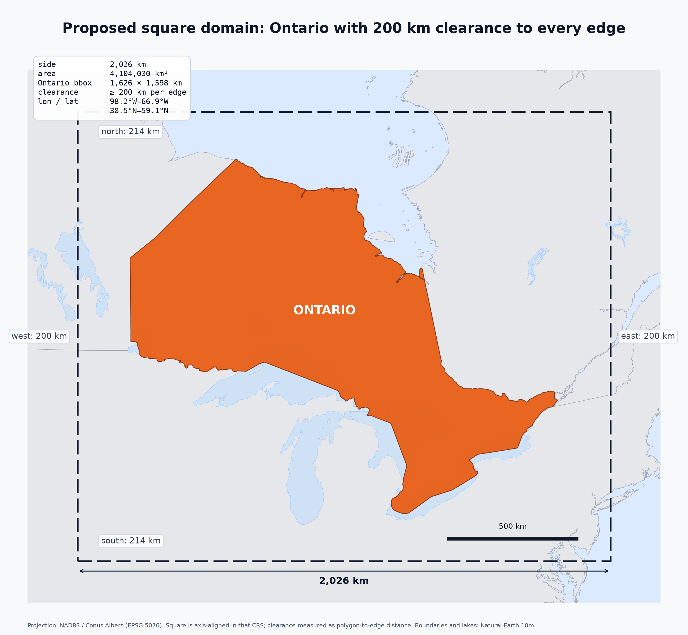
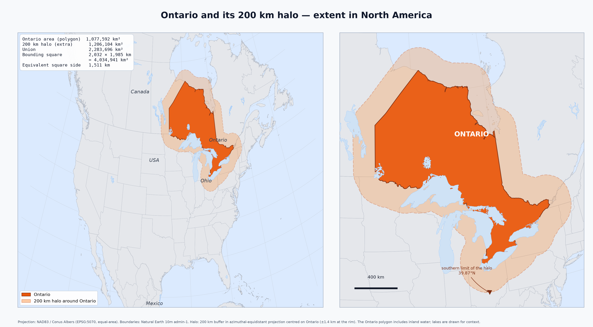

# Ontario square domain and 200 km halo — sizes

## The square

A true square, axis-aligned in NAD83 / Conus Albers (EPSG:5070), sized so that
**every edge is at least 200 km from the nearest point of Ontario**. It is the
Ontario bounding box expanded 200 km on each side and then squared up by
growing the shorter axis, with the centre held fixed.

| quantity | value |
|---|---|
| **Side** | **2,026 km** |
| **Area** | **4,104,030 km²** |
| Ontario bounding box (before the square-up) | 1,626 × 1,598 km |
| Clearance, west edge | 200.0 km |
| Clearance, east edge | 200.0 km |
| Clearance, north edge | 213.7 km |
| Clearance, south edge | 213.7 km |
| Geographic extent of the square | 98.2°W–66.9°W, 38.5°N–59.1°N |
| Square / Ontario area | 3.8× |

The east–west axis is the binding one (1,626 km of Ontario width), so the west
and east margins are exactly 200 km and the north–south margins inherit the
11.3 km of extra half-width each, giving 214 km.

Clearances are measured as polygon-to-edge distance in the projection, not
inferred from the construction.

## In a lat/lon raster this is not a rectangle

The projection matters. In Albers the domain is a square, but on the
EPSG:4326 rasters used for MAIAC and MERRA its edges become arcs: the bottom
edge dips to 38.5°N mid-span while its corners sit at 40.4°N. The lon/lat
bounding box — 98.2°W–66.9°W, 38.5°N–59.1°N, or 3,487 × 2,294 pixels on the
0.008983° MAIAC grid — projects to 2,668 × 2,522 km, i.e. 6.73M km²,
**1.64× the square's area**.

Two honest ways to use it:

1. **Exact** — keep the square in Albers and test each cell centre for
   point-in-square. Correct, a few lines of code at extraction time.
2. **Cheap** — take the lon/lat bounding box and accept 64% over-coverage
   (6.73M km² instead of 4.10M km²).

## The 200 km halo (for comparison)

A 200 km buffer around the provincial boundary (not a square):

| quantity | value |
|---|---|
| Ontario polygon | 1,077,592 km² |
| halo only | 1,206,104 km² |
| union | 2,283,696 km² |
| southern limit | 39.87°N, 82.68°W |

The square is 1.8× the area of the halo union, because a square must reach
the farthest point in both axes rather than following the boundary.

## Method notes

- Boundary: Natural Earth 10m admin-1 Ontario. The polygon follows the
  provincial boundary including the Great Lakes surface, so 1.0776M km² is
  the total provincial area (official 1,076,395 km²). Lakes are drawn on the
  maps for context but are inside the measured polygon.
- Buffer: 200 km in an azimuthal-equidistant projection centred on Ontario
  (50.07°N, 85.83°W); scale error at the rim ±1.4 km.
- Areas measured in EPSG:5070, an equal-area projection.
- Maps: Natural Earth 10m land, lakes and admin-1; graticule 10° × 5°.

## Files

| file | contents |
|---|---|
| `ontario_square.png` / `.json` | the square, and its numbers |
| `ontario_200km_halo.png` / `.json` | the halo variant |
| `../code/data_preparation/ontario_square.py` | square script |
| `../code/data_preparation/ontario_halo_area.py` | halo script |

